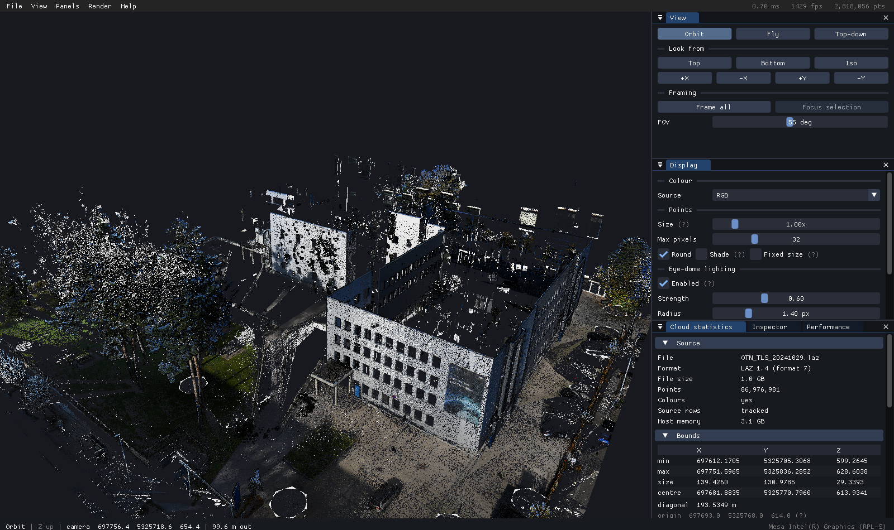
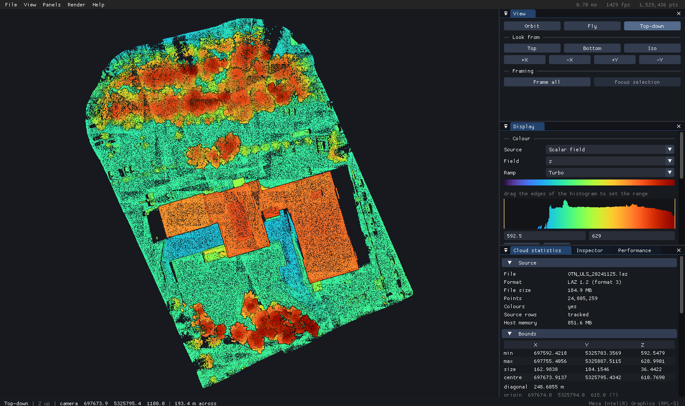

# punto

> A GPU-driven point cloud viewer for large clouds. 

Reads PCD, PLY, LAS, LAZ and raw KITTI `.bin`. Viewing is what exists today, but processing is
where this is going.



## Contents

- [Why](#why) — how this differs from `pcl_viewer`
- [Performance](#performance) — measured numbers on an 87 M-point scan
- [Installing](#installing) — the `.deb` for Ubuntu and Debian
- [Building](#building) — dependencies and the cmake invocation
- [Using it](#using-it) · [Controls](#controls)
- [Formats](#formats) — PCD, PLY, LAS, LAZ, raw `.bin`
- [Inspecting a cloud](#inspecting-a-cloud) — the statistics panel and `punto-probe`
- [Large files](#large-files) — estimating cost before opening, and opening what will not fit
- [How it works](#how-it-works) — the load, chunk and draw pipeline
- [Hybrid graphics](#hybrid-graphics) — which GPU gets used, and when not to force it
- [Tests](#tests) · [Releases](#releases) · [Status](#status) · [Licence](#licence) · [Attribution](#attribution)

## Why

I've been using `pcl_viewer` for years, but frequent crashes and limited features pushed me to start this project. `pcl_viewer` is a general-purpose VTK frontend designed to support all of PCL's data types, rather than being specifically optimized for large point clouds. The entire cloud is rendered as a single VTK actor, forcing every frame to redraw every point. There's no spatial subdivision, culling, or level of detail (LOD). Point coordinates are sent to the GPU as float32, and parsing is single-threaded.

punto is built the other way round:

|                       | `pcl_viewer`          | punto                                      |
| --------------------- | --------------------- | ------------------------------------------ |
| Per-frame CPU work    | grows with cloud size | constant — one dispatch, one indirect draw  |
| Culling               | none                  | per-chunk, on the GPU                       |
| Level of detail       | none                  | continuous, zero extra memory               |
| GPU vertex size       | 16–32 B/point         | 8 B positions + 4 colour + 2 scalar         |
| Loading               | single-threaded       | all cores, straight out of an `mmap`        |
| Fields                | fixed point structs   | whatever the file declares, natively typed  |
| Inspection            | —                     | per-field statistics, histograms, picking   |
| Cost known before load| —                     | peak RAM and VRAM predicted from the header |

## Performance

Measured on an RTX 5060 Laptop GPU with an 86,976,981-point, 1.0 GB LAZ
terrestrial scan (LAS 1.4 format 7: position, intensity, RGB and nine more
fields), 28 worker threads, page cache warm. Loading and chunking are CPU
work and do not depend on the GPU.

| | |
| --- | --- |
| Open to first frame | **5.9 s** (4.6 s decompress · 1.3 s chunk · upload) |
| Frame time @ 1920×1080 | **0.48 ms median, 2098 fps** (p95 0.60 ms) |
| Points drawn at overview | ~850 k of 87.0 M (~1%) |
| VRAM | 1161 MB of 8151 |
| Host RAM | 6.1 GB peak |

The frame cost tracks screen area, not cloud size: a chunk 500 m away whose
100,000 points land on 40 pixels is drawn with 40 points, because the other
99,960 cannot be seen. That is why 87 M points here cost the same per frame
as a third as many did — the screen did not get any bigger.

Almost all of the open is LAZ decompression, which is CPU-bound and
inherent to the format. Uncompressed data is an order of magnitude faster:
a 320 MB binary PCD loads at **1545 MB/s**, 20 M points in 207 ms, against
249 MB/s for LAZ. Decompression does at least scale across cores — 3 M
points in 179 ms on 28 threads against 1440 ms on one.

The same scene on the integrated GPU runs at 10.5 ms, 95 fps — still
interactive, because LOD has already capped the work at roughly what the
screen can show. See *Hybrid graphics* below for when that path gets used.

## Installing

Ubuntu 22.04 or newer and Debian 12 or newer, on x86-64: download the
`.deb` from the [releases page](https://github.com/omerssid/punto/releases)
and install it with apt, which pulls in the libraries it needs:

```sh
sudo apt install ./punto_0.1.0_amd64.deb
```

This installs `punto-viewer` and `punto-probe`, an entry in the
application menu, and file associations for `.pcd`, `.ply`, `.las` and
`.laz`. `sudo apt remove punto` takes it all out again.

The packaged binary is built without `-march=native` so it runs on any
x86-64 CPU. Building from source gives one tuned to your own machine,
which is faster on the load path.

## Building

Needs **GCC 13 or newer**, CMake 3.20+ and OpenGL 4.6. `std::format` is used
throughout, and libstdc++ only shipped it in GCC 13 — Ubuntu 24.04 has it,
22.04 ships GCC 11 and needs a newer one:

```sh
# Ubuntu 22.04 only
sudo add-apt-repository ppa:ubuntu-toolchain-r/test
sudo apt install g++-13      # then add -DCMAKE_CXX_COMPILER=g++-13 below
```

```sh
sudo apt install build-essential cmake libglfw3-dev libglew-dev libgl1-mesa-dev
sudo apt install liblaszip-dev libxrandr-dev   # optional: LAZ, PRIME detection
```

```sh
cmake -S . -B build -DCMAKE_BUILD_TYPE=Release
cmake --build build -j
```

`sudo cmake --install build` puts it under `/usr/local`, and `cpack` in
the build directory makes a `.deb` instead.

Dear ImGui is vendored, so there is nothing else to fetch. Both optional
dependencies are detected at configure time and the build reports what it
found. Shaders are embedded into the binary, which is a single ~2 MB file.

| CMake option | Default | |
| --- | --- | --- |
| `PUNTO_NATIVE_ARCH` | `ON` | `-march=native`. **Turn off for binaries you distribute** — otherwise they crash on older CPUs. |
| `PUNTO_WERROR` | `OFF` | warnings as errors |
| `PUNTO_DEV_SHADER_DIR` | `ON` | compiles in the source tree's `shaders/` path so `R` reloads edits from it. Turn off for anything you distribute, so installed binaries always use their embedded shaders. |
| `PUNTO_STATIC_CXX_RUNTIME` | `OFF` | links libstdc++ and libgcc statically. For binaries built on an older distribution to run on newer ones: the glibc requirement comes from the build host, but libstdc++ comes from the compiler, so a GCC 13 binary built on 22.04 otherwise demands a libstdc++ that 22.04 does not have. |

Two environment variables are read at runtime: `PUNTO_THREADS` caps worker
threads, and `PUNTO_GL_SYNC_DEBUG=1` forces synchronous GL debug output, which
reports driver errors at the call that caused them but serialises the
pipeline. `PUNTO_SHADER_DIR` points the shader loader at a directory so `R`
reloads from disk.

## Using it

```sh
./build/punto-viewer cloud.pcd          # or drag a file onto the window
./build/punto-viewer --color scalar --field intensity --ramp turbo scan.las
./build/punto-viewer --nav top map.laz  # open straight into the map view
./build/punto-viewer --max-points 20000000 huge.laz   # thin a cloud that will not fit
```



A 24.8 M-point UAV scan in top-down mode with height mapped through Turbo.
The histogram under the ramp is the field's real distribution; dragging its
edges sets the colour range, which is how you pull detail out of a channel
whose nominal range is set by a handful of outliers.

### Controls

| | |
| --- | --- |
| left drag | orbit |
| middle / right drag | pan |
| scroll | zoom |
| **shift + click** | select a point |
| **double click** | select and focus |
| `1` `2` `3` | orbit / fly / top-down |
| `W A S D` `Q E` | fly; `shift` faster, `alt` slower |
| `F` | frame the whole cloud |
| `Tab` | show or hide all panels |
| `C` `E` `L` | cycle colour · toggle EDL · toggle LOD |
| `R` | reload shaders from disk |

`--help` lists the full command line, including `--screenshot`,
`--benchmark` and `--pick`, which drive the viewer without an interactive
session, and the memory flags described under [Large files](#large-files).

## Formats

| | |
| --- | --- |
| **PCD** | `ascii`, `binary`, `binary_compressed` (LZF decoded in-tree) |
| **PLY** | `ascii`, `binary_little_endian`, `binary_big_endian` |
| **LAS** | point data record formats 0–10, LAS 1.0–1.4 |
| **LAZ** | via `laszip`, decompressed in parallel |
| **`.bin`** | headerless KITTI-style float32 tuples |

Files are identified by content, not extension, so a mislabelled one still
opens. Arbitrary fields come through with the exact type the file declared —
a `uint8` ring stays one byte, a `float64` GPS time keeps every bit it can —
and any of them can be used as a colour source.

## Inspecting a cloud

The viewer answers "what is actually in this file" in the Cloud statistics
panel: exact bounds, every field with its type, range, mean, standard
deviation and distribution, per-channel colour histograms, invalid point
counts, and where the load time went.

`shift`-clicking a point shows every field it carries at full precision —
and its **row in the source file**, which is not the same as its index in
memory, because chunking reorders points. Measure mode chains picks and
reports 3D distance along with horizontal and vertical components
separately.

The same report is available from the terminal:

```
$ punto-probe scan.laz

  format        LAZ 1.2 (format 3)
  file size     184.9 MB
  points        24,805,259
  resident      851.6 MB
  colors        yes
  source rows   tracked

  bounds (world)
    min        697592.4218     5325703.3569         592.5479
    max        697755.4056     5325887.5115         628.9901
    size          162.9838         184.1546          36.4422
    diag  248.6055 m
  origin       697674.0000     5325794.0000         615.0000

  fields
    name           type      role                  min            max           mean       stddev  distribution
    x              int32     position      697592.4218    697755.4056    697667.4344      29.9358  ▅▆▆▇▇▇▇▇▇▇▇▇▇▇▇▆▆▆▆
    y              int32     position     5325703.3569   5325887.5115   5325809.0050      43.1996  ▆▆▇▇▇▇▇▇▇▇▇▇▇▇▇▇▇▇▆
    z              int32     position         592.5479       628.9901       610.8141       6.6631  ▁    ▁▆▆▇▆▆▆▆▆▆▆▇▆▅
    intensity      uint16    intensity          0.0000       255.0000        26.5315      23.7608  ▇▇▇▇▇▇▆▆▆▆▅▅▅▄▃▃▃▂▂
    return_info    uint8     other              9.0000        45.0000        16.5473       9.7301  ▇    ▇▇   ▆▆▆  ▆▆▆▅
    classification uint8     label              0.0000         0.0000         0.0000       0.0000  ▇
                     1 distinct: 0
    scan_angle     int8      other            -36.0000        35.0000         0.1746      24.1767  ▇▇▇▇▇▇▇▇▇▇▇▇▇▇▇▇▇▇▇
    user_data      uint8     other              0.0000       255.0000       125.9368     107.0430  ▇▇▇▇                ▇▇▇▇
    gps_time       float64   time       416582038.2646 416582112.2651 416582075.1011      19.3163  ▇▇▇▇▇▇▇▇▇▇▇▇▇▇▇▇▇▇▇
    red            uint16    color      packed -> colour channels below
    green          uint16    color      packed -> colour channels below
    blue           uint16    color      packed -> colour channels below

  colour channels
    red            uint8     color                   0            254         112.82        52.62  ▇▅▆▆▇▇▇▇▇▇▇▇▇▇▇▇▆▆▆
    green          uint8     color                   0            254         107.09        46.55  ▇▅▆▆▇▇▇▇▇▇▇▇▇▇▇▇▆▆▅
    blue           uint8     color                   0            254          99.05        48.31  ▇▆▆▇▇▇▇▇▇▇▇▇▇▇▇▆▆▆▆

  load  1190 ms total   (163 MB/s)
    map 0.0  header 0.0  decode 1060.0  stats 120.5  (ms)
    28 worker threads
```

Add `--chunks` to also build the chunk tree and report its shape, GPU memory
and quantization error.

## Large files

A point cloud that does not fit in memory does not fail politely. The
desktop goes to swap, the page cache is evicted, and the kernel's OOM
killer picks whichever process it scores highest — which is rarely the one
that caused the pressure. The first thing you see is a frozen screen.

So punto checks before it allocates. `--estimate` reads only the header:

```
$ punto-probe --estimate scan.laz

  LAZ 1.4 (format 7)
  file size     1.0 GB
  points        86,976,981
  record        36 B x 14 declared fields
  fields        x y z intensity return_info class_flags classification
                user_data scan_angle point_source_id gps_time red green blue

  predicted cost
    per point     38 B in RAM
    decode buffer 2.9 GB   (decompressed records, freed after load)
    point cloud   3.1 GB
    chunk scratch 1.3 GB   (transient, during chunk building)
    peak RAM      6.0 GB   (6.9 GB allowing for allocator overhead)
    GPU vertex    1.1 GB

  host          20.7 GB available of 31.1 GB
  verdict       fits comfortably
```

That takes 4 ms on a 1 GB file, against 5.5 s to load it properly. The
viewer runs the same check on every open and refuses, naming both figures,
rather than trying and taking the session down with it. `--force` overrides
it. punto also raises its own `oom_score_adj` at startup, so if memory does
run out the kernel kills the viewer instead of your browser.

When a file genuinely will not fit, two flags make it open anyway:

| Flag | Effect |
| --- | --- |
| `--max-points N` | Keep every Nth point so the cloud still covers the same ground, rather than the first N, which would cover a corner of it. |
| `--drop-fields A,B` | Leave named scalar fields undecoded and uncolumned. Positions and colour are never dropped. |

Dropping has to happen before the decode: a column freed afterwards has
already cost the peak you could not afford. On the 87M-point scan above,
GPS time alone is 8 bytes a point, and five more fields are constant zero.

```
                                     peak RAM   load
  as-is                                6.01 GB   5485 ms
  --drop-fields gps_time,...           4.80 GB
  --max-points 20000000                3.55 GB
  both                                 3.32 GB   3167 ms
```

Predictions match measurements within 1.5% across all four.

## How it works

```
 LOAD        mmap → sniff format → parse header → decode on every core
                                                → columnar arrays + statistics
 SPATIALIZE  Morton sort → linear octree → shuffle points within each chunk
 UPLOAD      quantise to 8 B/point → VRAM
 RENDER      compute shader culls chunks and picks each one's detail level
             → one MultiDrawArraysIndirectCount → EDL → ImGui
```

A few decisions that matter more than they look:

**World space is double precision.** HD maps sit at UTM-like coordinates
where float32 resolves to about half a metre. Positions are rebased onto a
double origin at parse time, so float32 then gives sub-millimetre precision
across a multi-kilometre map at 12 bytes a point.

**Level of detail is a prefix.** Points are shuffled within each chunk at
load, so the first N of them are a uniform sample of that chunk for any N.
Drawing less detail means drawing fewer points of the same array — no
duplicated data, no popping, and the prefix is contiguous, so it will stream
from disk just as well when out-of-core lands.

**Depth is reversed.** Near maps to 1 and infinity to 0, against a float
depth buffer. A map spanning 0.1 m to 2 km does not z-fight.

**Splats are sized from measured point spacing**, widened by the square root
of however much LOD thinned the chunk, so a chunk drawn at 1/16 detail gets
4× wider points and stays a surface instead of turning to confetti.

Chunk supply sits behind a `ChunkSource` interface. `RamChunkSource` holds
everything in memory today; a disk-backed streaming implementation can
replace it without the renderer, the LOD selector, the culling pass or the
UI changing.

## Hybrid graphics

On a laptop with both an integrated and a discrete GPU, a program that does
nothing special renders on the integrated one. This
viewer selects the discrete GPU itself at startup, with no wrapper script.

The exception is when an external monitor is wired to the discrete GPU while
the X screen renders on the integrated one (reverse PRIME). Frames are
already being copied between GPUs for scanout, and forcing render offload on
top of that sends every frame across the bus twice — enough to wedge a
2560×1440 display, not merely slow it. `--gpu auto` detects this, declines,
and says so. `--gpu nvidia` forces it anyway.

## Tests

```sh
python3 tests/make_fixtures.py     # writes tests/fixtures/
ctest --test-dir build --output-on-failure
```

Around 20,500 assertions. The loader suite writes the same helix in every
encoding and demands they decode identically — with `binary_compressed`
produced by PCL and LAZ by `laszip`, so those paths are checked against the
reference implementations rather than against our own writers. The chunk
suite covers coverage and contiguity, that attributes stay attached to their
points through the reorder, the LOD prefix property, determinism, and
quantization round-trip. Both suites are CPU-only and need no GPU.

Fixtures requiring PCL or laszip are skipped when those are absent.

## Releases

`.github/workflows/build.yml` builds, tests and packages a `.deb` on every
push, then installs that package in clean Ubuntu 22.04, Ubuntu 24.04,
Debian 12 and Debian 13 containers and checks that it runs and removes
cleanly. Only when all four pass does it publish. A push to the default
branch replaces a rolling `latest` prerelease carrying
`punto_latest_amd64.deb`, and a `v*` tag cuts a permanent release.

Release builds set `-DPUNTO_NATIVE_ARCH=OFF` and run on Ubuntu 22.04. Both
matter: `-march=native` would bake in whatever instructions the build
machine happens to have, and a binary runs on the glibc it was built
against or newer, so building on 22.04 covers 22.04 and 24.04 while
building on 24.04 would not run on 22.04.

The version lives in one place, `project(punto VERSION …)` in
`CMakeLists.txt`, and a tag that disagrees with it fails the build. To cut
a release:

1. Set the version in `CMakeLists.txt` and commit.
2. `git tag v0.1.0 && git push origin main v0.1.0`
3. Bump the version to the next one (say `0.2.0`) and commit.

Step 3 matters for the rolling build. Snapshots are versioned
`<version>~git<date>.<hash>`, and `~` sorts *before* the plain version, so
`0.2.0~git…` upgrades cleanly to `0.2.0` once it ships. Skipping the bump
would leave snapshots versioned `0.1.0~git…`, which apt considers older
than the `0.1.0` already released.

A second job builds without `laszip` or `Xrandr` and runs the suite again,
because those sit behind compile-time checks and are otherwise never
exercised — the tests detect the missing library and assert that a `.laz`
file is refused with instructions rather than crashing.

## Status

Viewing is complete and in daily use. In-core, comfortable to about 150 M
points.

Planned, in rough order:

- **Out-of-core streaming**, for clouds past 150 M points. The `ChunkSource`
  interface the renderer draws through already exists for this; a
  disk-backed implementation slots in behind it without the renderer, LOD
  selector, culling pass or UI changing.
- **Post-processing** — filtering, downsampling, normal estimation.
- **Segmentation and object removal** — isolating and deleting things like
  parked cars from a map.

The last two need something the current design does not have: the cloud is
loaded once and treated as immutable all the way down, so editing it means
reworking how chunks, the GPU buffers and the source-row mapping stay in
step when points disappear. Worth knowing before building on this.

## Licence

MIT — see [LICENSE](LICENSE).

Vendored dependencies keep their own: [Dear ImGui](third_party/imgui/LICENSE.txt)
(MIT) and `stb_image_write` (public domain / MIT, stated in the header).
`laszip` is linked optionally at build time and is licensed LGPL-2.1, so it is
a dependency rather than a bundled component.

## Attribution

Developed with assistance from Claude (Anthropic).
